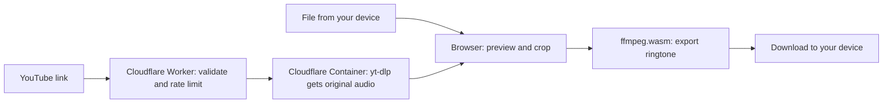

# Ringtone Cropper

**Your favorite moment. Your next ringtone.**

Make high-quality ringtones for **Android and iPhone** from an audio file or a YouTube link. Choose the moment, fine-tune the sound, and download it from your browser.

[Open the editor](https://ringtone.apoorvdarshan.com) · [Source code](https://github.com/apoorvdarshan/ringtone-cropper) · [Report an issue](https://github.com/apoorvdarshan/ringtone-cropper/issues)

## Make it yours

1. **Bring your audio.** Paste a permitted YouTube link, choose a file, or drop audio/video onto the editor.
2. **Pick the moment.** Start with exactly **30 seconds**, choose **15 / 30 / 40 seconds**, or adjust the selection and start/end times yourself.
3. **Save for your phone.** Choose Android or iPhone, preview the clip, and download your ringtone.

The editor starts on the loudest stretch of the track as a useful first suggestion. Drag the waveform selection, resize its ends, or use the arrow keys to move it precisely. Repeat preview, fade in/out, and optional volume normalization help finish the clip.

Choose **Light**, **Dark**, or **System** appearance. System is the default and follows your device's setting; your choice is remembered locally in your browser.

## Audio quality

| Export | Best for | Encoding |
| --- | --- | --- |
| **MP3** | Android ringtone | 320 kb/s MP3 |
| **M4A** | iPhone, including GarageBand import | 320 kb/s AAC |
| **M4R** | Other iPhone ringtone workflows | 320 kb/s AAC |
| **WAV** | Further editing or an uncompressed copy | Float PCM, no added lossy compression |

YouTube imports select the best available audio stream and send the original encoded audio to your browser without an intermediate lossy conversion. Exports use the original source. Higher export bitrates cannot restore detail missing from that source.

Sources can be up to **20 minutes / 100 MiB**; clips can be up to **40 seconds**. For the iPhone GarageBand workflow, use **30 seconds or less**—GarageBand shortens longer ringtones.

## Put it on your phone

**Android**

1. Download the MP3.
2. Open **Files by Google → Audio**, then play the downloaded file.
3. Choose **More → Set as ringtone** and allow system settings access if prompted.

[Google's ringtone instructions](https://support.google.com/files/answer/10018943?hl=en)

**iPhone**

1. Save the M4A file to Files.
2. In GarageBand, open Audio Recorder → Tracks → Loops → Files and import the clip at the start. Set the song section to **Automatic** so the full clip imports.
3. Open My Songs, select the project, then **Share → Ringtone → Export → Use sound as → Standard Ringtone**.

[Apple's ringtone instructions](https://support.apple.com/en-us/120692) · [Importing audio into GarageBand](https://support.apple.com/guide/garageband-iphone/chsab9d208e/ios)

The website creates the audio file; your phone's apps/settings apply it as a ringtone. No account is needed to use the editor.

## Where the audio goes



Files you choose from your device are processed in your browser and are **not uploaded to our server**. YouTube imports send the video link to the backend, which temporarily downloads the audio and is designed to remove its working files when the request finishes or is canceled. Cropping and export then run in your browser.

Cloudflare handles hosting and request traffic. Google Fonts serves fonts, and jsDelivr provides the ffmpeg engine. These providers can receive normal connection information such as IP addresses. See the [Privacy Policy](https://ringtone.apoorvdarshan.com/privacy) for details.

Only use audio you have permission to download and edit, and follow the source platform's terms. A publicly accessible video does not by itself grant download rights. This independent project is not affiliated with YouTube, Google, or Apple. See the [Terms & Disclaimer](https://ringtone.apoorvdarshan.com/terms).

## Develop locally

The public editor uses plain HTML, CSS, and JavaScript, [ffmpeg.wasm](https://github.com/ffmpegwasm/ffmpeg.wasm), a Cloudflare Worker, and a Node.js/yt-dlp container.

```sh
npm install
```

Create an ignored `.dev.vars` file containing a development-only `BACKEND_TOKEN` of at least 24 characters. With Docker running:

```sh
npm run dev
```

The public editor lives in `public/`; `worker.mjs` handles `/api/youtube`; `cloudflare.mjs` connects the gateway to `backend/`. `public/vendor/` contains the ffmpeg JavaScript wrappers. The approximately 32 MB ffmpeg WebAssembly core loads from jsDelivr because it exceeds Cloudflare's 25 MiB static-asset limit.

### Checks

```sh
npm run check
npm test
```

Tests cover gateway routing, URL validation, authentication, download limits, concurrency, cancellation, temporary-file cleanup, and local audio exports. Check a real YouTube import after changing the backend: YouTube can challenge cloud IP addresses even when automated checks pass.

### Deploy to Cloudflare

Production uses Cloudflare static assets, a Worker gateway, and one `basic` Container that sleeps after 60 seconds of inactivity. The container image is pinned by digest in `wrangler.jsonc`. A first import may take longer while it starts.

Set a random production secret and deploy:

```sh
wrangler secret put BACKEND_TOKEN
npm run deploy
```

The secret must contain at least 24 characters. It is passed to the backend by the Worker; never place it in browser code or commit it. A new deployment on your own account also needs your domain, container image reference, and Cloudflare account configuration in `wrangler.jsonc`.

When changing the backend, build and push its image with Docker available:

```sh
wrangler containers build -p -t ringtone-cropper-api ./backend
```

Update the image digest in `wrangler.jsonc`, then deploy. Frontend-only updates reuse the pinned image. The gateway also supports `YOUTUBE_BACKEND_URL` when adapting the project to an external backend.

The gateway allows ten import attempts per minute per IP. The backend allows two simultaneous downloads and enforces the source-size/duration limits and a four-minute processing timeout. Private, live, restricted, or unavailable videos can fail to import; local-file cropping remains available.

### Separate local editor

The [local editor](local/README.md) runs Node, FFmpeg, and yt-dlp on your computer and saves exports to Downloads. It is useful without Docker or hosted infrastructure.

Install Node.js 22 or later, FFmpeg (including ffprobe), and yt-dlp. On macOS:

```sh
brew install node ffmpeg yt-dlp
npm run local
```

Open [localhost:3005](http://localhost:3005). This editor lives in `local/` and does not require an npm dependency install. Its setup and export options are documented separately.

## Built by Apoorv Darshan

[X · @apoorvdarshan](https://x.com/apoorvdarshan) · [LinkedIn](https://www.linkedin.com/in/apoorvdarshan/) · [Instagram · @apoorvcodes](https://www.instagram.com/apoorvcodes/) · [GitHub · @apoorvdarshan](https://github.com/apoorvdarshan)

Ideas, bugs, or feedback? [Open a GitHub issue](https://github.com/apoorvdarshan/ringtone-cropper/issues). Please keep private audio and personal information out of public issues.
